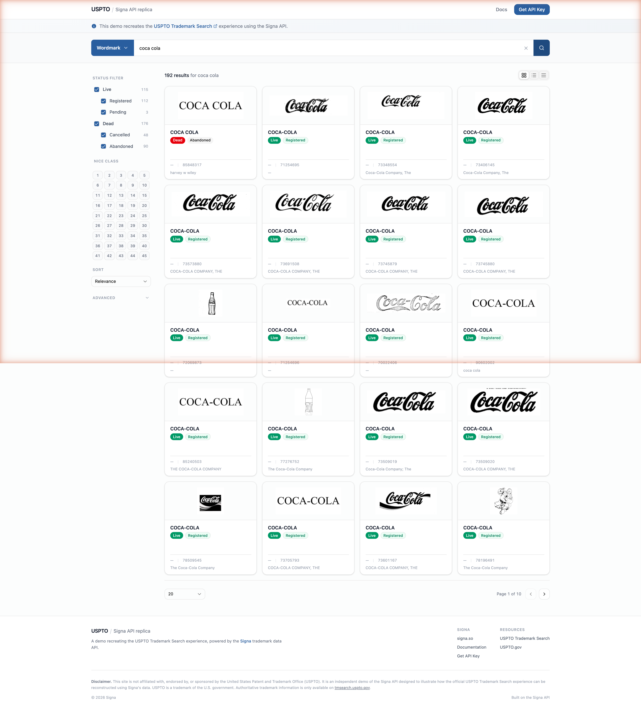

# USPTO Trademark Search

An open showcase recreating the [USPTO Trademark Search](https://tmsearch.uspto.gov) experience on the [Signa API](https://docs.signa.so). Fork it, paste in your own API key, and you have a working trademark search UI in under a minute.

**Live demo:** [uspto.signa.so](https://uspto.signa.so)



## Quick start

Prereqs: **Node 20+** and a Signa API key.

```bash
git clone https://github.com/signa-so/demo-uspto-trademark-search.git
cd demo-uspto-trademark-search
npm install
cp .env.example .env
# open .env and paste your key into VITE_SIGNA_API_KEY
npm run dev
```

The dev server runs at `http://localhost:5173` and proxies `/api/*` to `https://api.signa.so`, so no CORS config is needed.

### Get an API key

Head to [docs.signa.so/quickstart](https://docs.signa.so/quickstart). Free tier is enough to play with this app.

## Deploy your own

[](https://vercel.com/new/clone?repository-url=https://github.com/signa-so/demo-uspto-trademark-search&env=VITE_SIGNA_API_KEY&envDescription=Your%20Signa%20API%20key%20from%20docs.signa.so)

Vercel clones the repo, prompts for `VITE_SIGNA_API_KEY`, and picks up [vercel.json](./vercel.json) which rewrites `/api/*` to `api.signa.so`. That's the whole config.

## Signa endpoints used

| Endpoint | Purpose |
|---|---|
| `POST /v1/trademarks` | Search by query + filters, or lookup by serial / registration number |
| `GET /v1/trademarks/{id}` | Full mark detail (owners, attorneys, deadlines, design codes, statements…) |
| `GET /v1/trademarks/{id}/history` | Prosecution timeline events |
| `GET /v1/trademarks/{id}/proceedings` | TTAB proceedings |

Full reference: [docs.signa.so](https://docs.signa.so).

## Tech

Vite · React 19 · TypeScript · Tailwind CSS v4 · shadcn/ui · Base UI · lucide-react.

## Disclaimer

This project is not affiliated with, endorsed by, or sponsored by the United States Patent and Trademark Office (USPTO). "USPTO" and the design of its Trademark Search tool are the property of the U.S. government. This repo is an independent demo of the Signa API that illustrates how that experience can be reconstructed. Authoritative trademark information is only available on [tmsearch.uspto.gov](https://tmsearch.uspto.gov).

## License

MIT — see [LICENSE](./LICENSE).
